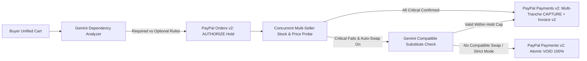

# AtomPay — Atomic Multi-Seller Checkout for PayPal

**AtomPay** solves the **multi-vendor partial-failure trap** in online PayPal checkouts. When buying dependent items across multiple independent sellers (like a camera body from Seller A and a compatible lens from Seller B), PayPal normally settles each order immediately—leaving buyers financially stranded if one seller goes out of stock or spikes in price.

AtomPay introduces an **AI-guided Two-Phase Commit (2PC) protection layer** built directly on PayPal’s `Orders v2 AUTHORIZE` and `Payments v2 Partial CAPTURE / VOID` APIs.

---

## Architecture



---

## Key Capabilities

- **Multi-Seller Storefront & Custom Cart:** Browse cross-store items, generate custom bundles from natural language via Gemini, or add any custom seller item.
- **PayPal `AUTHORIZE` Hold First:** Places a single PayPal Sandbox authorization hold (`intent: "AUTHORIZE"`) via the PayPal JS Checkout SDK without charging the buyer prematurely.
- **Concurrent Pre-Commit Seller Verification:** Probes every seller’s live stock and price before capturing funds. Includes per-seller availability controls to test `Out of Stock`, `Price Spike (+28%)`, and `Seller Timeout`.
- **AI Substitute Recovery or Atomic Rollback:** Automatically swaps a failed required seller with a compatible backup within budget (when enabled), or voids 100% of the PayPal hold (`POST /v2/payments/authorizations/{id}/void`).
- **Partial Commit Support:** Drops failed `Optional` add-ons cleanly via `final_capture: true` on the remaining verified tranches, releasing unused authorized funds automatically.
- **AG Grid Orders & Settlement Ledger:** Searchable, filterable financial ledger with KPI metrics and CSV/JSON audit export.
- **Live PayPal REST API Trace:** Inspect real `oauth2/token`, `v2/checkout/orders`, `authorize`, `capture`, `void`, and `v2/invoicing/invoices` payloads and latencies.

---

## Local Setup (For Judges & Developers)

1. **Clone & configure environment variables:**
   ```bash
   git clone https://github.com/SaiSanthosh31/atompay-paypal.git
   cd atompay-paypal
   cp .env.example .env
   ```
   Fill in `.env`:
   - `PAYPAL_CLIENT_ID` & `PAYPAL_CLIENT_SECRET` (from [PayPal Developer Dashboard](https://developer.paypal.com) → **Apps & Credentials → Sandbox**)
   - `GEMINI_API_KEY` (from Google AI Studio)

2. **Install & run:**
   ```bash
   npm run install:all
   npm run dev
   ```
   - Web App: `http://localhost:5173`
   - Backend API: `http://localhost:4000`

3. **Production Build & Deploy (Render Blueprint included in `render.yaml`):**
   ```bash
   npm run build
   npm run start
   ```

## License

MIT — see [`LICENSE`](./LICENSE).
