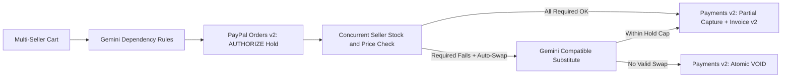

# AtomPay

Atomic multi-seller checkout for PayPal. Prevents buyers from getting charged for partial, unusable orders when buying dependent items across separate stores.

## The Problem

PayPal processes multi-seller orders (`purchase_units`) with immediate `CAPTURE` and explicitly blocks `intent: "AUTHORIZE"` across multiple purchase units (`UNSUPPORTED_INTENT`). Because there is no cross-seller dependency check or rollback:

- If you buy a camera body from Seller A and a compatible lens from Seller B, Seller A captures your money immediately.
- If Seller B goes out of stock, spikes in price, or fails fulfillment right after checkout, Seller A already took your funds and shipped—leaving you with half an unusable setup and manual refund disputes.

## How AtomPay Solves It

1. **Multi-Seller Cart & Dependency Rules:** Shop across independent sellers, generate a bundle from a text prompt via Gemini, or add custom seller items. Mark each item as **Required together** or **Optional add-on**.
2. **PayPal Authorization Hold (`Orders v2`):** Places one `intent: "AUTHORIZE"` hold via the PayPal JS Checkout SDK without charging upfront.
3. **Concurrent Seller Probe:** Verifies live inventory and price across all sellers before capturing any funds.
4. **Atomic Settlement or Rollback (`Payments v2`):**
   - **All required sellers confirm:** Executes sequential tranche captures (`POST /v2/payments/authorizations/{id}/capture`, setting `final_capture: true` on the final leg) and generates a receipt via `Invoicing v2`.
   - **Required seller fails (Auto-Swap ON):** Gemini selects a technically compatible substitute from another seller within the existing PayPal hold cap.
   - **Required seller fails (No swap / Strict mode):** AtomPay fires `POST /v2/payments/authorizations/{id}/void` across the hold so **$0.00** is charged.
   - **Optional item fails:** Drops only the optional item and captures the remaining confirmed tranches.

## Architecture



## PayPal REST Endpoints Integrated

- `POST /v1/oauth2/token`
- `POST /v2/checkout/orders` (`intent: "AUTHORIZE"`)
- `POST /v2/checkout/orders/{id}/authorize`
- `POST /v2/payments/authorizations/{id}/capture`
- `POST /v2/payments/authorizations/{id}/void`
- `POST /v2/invoicing/invoices`

## Local Setup

1. Copy `.env.example` to `.env` and fill in your credentials:
   - `PAYPAL_CLIENT_ID` and `PAYPAL_CLIENT_SECRET` from PayPal Developer Dashboard (Sandbox)
   - `GEMINI_API_KEY` from Google AI Studio (`GEMINI_MODEL=gemini-flash-latest`)
2. Install dependencies and start dev servers:
   ```bash
   npm run install:all
   npm run dev
   ```
   - Frontend: `http://localhost:5173`
   - Backend: `http://localhost:4000`
3. Build for production:
   ```bash
   npm run build
   npm run start
   ```

## Testing the 3 Core Flows

1. **Full Settlement:** Load `Creator Camera Kit`, click **Continue to PayPal Checkout**, approve the PayPal Sandbox hold, and click **Verify Sellers & Complete Order**. Check **Orders & Ledger** (AG Grid) and **API Logs**.
2. **Atomic Rollback ($0 Charged):** Load `Creator Camera Kit`, uncheck **Auto-swap compatible seller if out of stock**, authorize the PayPal hold, set `OpticVault Pro` to **Simulate Out of Stock** (or **Simulate Delayed**), and verify. PayPal immediately voids the hold.
3. **Compatible Auto-Swap:** Keep **Auto-swap** checked, set `OpticVault Pro` to **Simulate Out of Stock** after authorizing, and verify. Gemini swaps in a compatible Sony body from `CineGear Direct` inside the existing PayPal hold and settles.

## License

MIT — see [LICENSE](./LICENSE).
