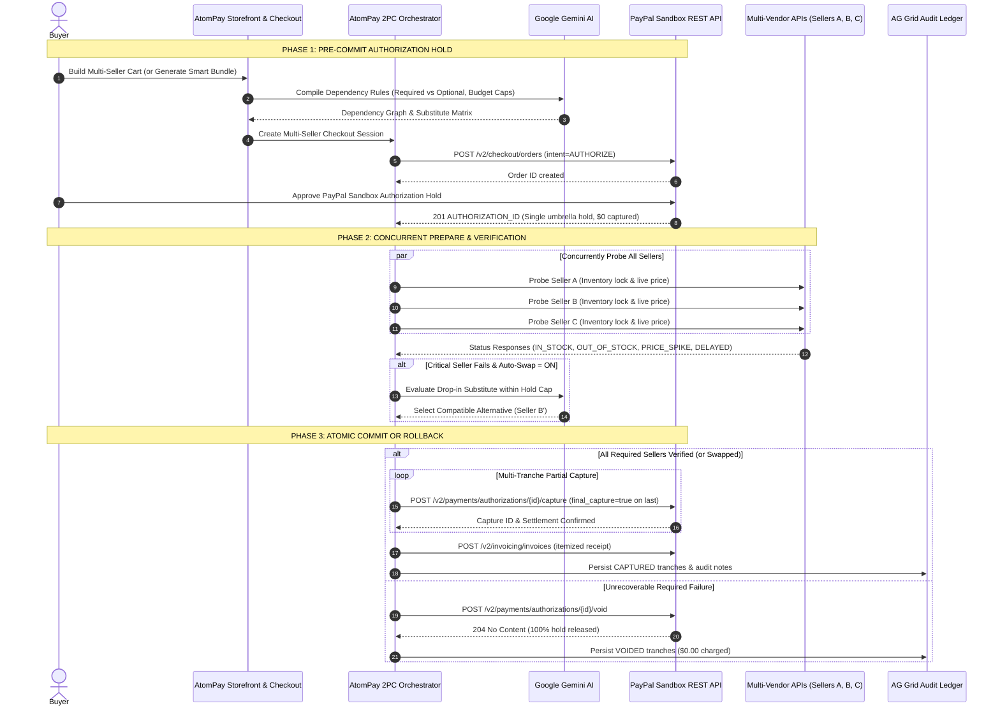

# AtomPay — AI-Guided Two-Phase Commit (2PC) Atomic Multi-Vendor Checkout for PayPal

[](LICENSE)
[](https://developer.paypal.com)
[](https://www.ag-grid.com)
[](https://ai.google.dev)
[](https://www.typescriptlang.org)

**AtomPay** solves the **multi-vendor partial-failure trap** in online PayPal checkouts. When buying interdependent items from multiple sellers (e.g., an E-mount camera body from Seller A and a compatible lens from Seller B), traditional checkouts settle each seller immediately. If Seller B goes out of stock or spikes in price moments later, Seller A's funds have already been captured—leaving buyers stranded with half an unusable setup and chasing manual refunds.

AtomPay brings **Distributed Two-Phase Commit (2PC)** into multi-seller commerce using **PayPal Orders v2 Authorization Holds**, **Google Gemini AI dependency & substitute reasoning**, and an **AG Grid Settlement & Audit Ledger**.

---

## Architecture & 2PC Sequence Diagram



---

## Key Features

### 1. Multi-Seller Storefront & AI Smart Bundle Builder
* **Shop Across Independent Sellers:** Browse curated bundles (*Creator Camera Kit*, *AI PC Workstation*, *Startup Cloud & API Pack*), add custom seller items, or describe a goal in the Smart Bundle bar so Gemini assembles a compatible multi-seller cart.
* **Per-Item Dependency Rules:** Toggle any item between **Required together** and **Optional add-on**, and toggle **Auto-swap compatible seller if out of stock**.

### 2. Direct PayPal Sandbox REST v2 Integration
* `POST /v1/oauth2/token` — OAuth 2.0 Bearer token generation & caching
* `POST /v2/checkout/orders` — Orders v2 with `intent: AUTHORIZE`
* `POST /v2/checkout/orders/{id}/authorize` — Locks umbrella buyer hold
* `POST /v2/payments/authorizations/{id}/capture` — Sequential multi-tranche captures (`final_capture: true` on final leg)
* `POST /v2/payments/authorizations/{id}/void` — Instant 100% atomic hold release
* `POST /v2/invoicing/invoices` — PayPal Invoicing v2 itemized settlement receipt

### 3. AG Grid Settlement & Audit Ledger
* Powered by `ag-grid-react` & `ag-grid-community` v33 with KPI summary cards, instant QuickFilter search, status pills (`All`, `Settled`, `Voided / Failed`, `AI Swapped`), and one-click **Export CSV** / **Export JSON**.
* Persists order sessions and ledger tranches locally in `backend/data/store.json`.

---

## Quick Start Guide

### 1. Configure `.env`
```bash
cp .env.example .env
```
Fill in:
* `PAYPAL_CLIENT_ID` & `PAYPAL_CLIENT_SECRET` from [PayPal Developer Dashboard](https://developer.paypal.com) (**Apps & Credentials → Sandbox**)
* `GEMINI_API_KEY` from Google AI Studio (`GEMINI_MODEL=gemini-flash-latest`)

### 2. Install & Run
```bash
npm run install:all
npm run dev
```
* **Web App:** `http://localhost:5173`
* **Backend API:** `http://localhost:4000` (`GET /api/health`)

### 3. Judge Test Flows (Under 3 Minutes)
1. **Happy Path (All Sellers Confirmed):** Load **Creator Camera Kit** → **Continue to PayPal Checkout** → approve with PayPal Sandbox Buyer → click **Verify Sellers & Complete Order** → inspects multi-tranche captures in **Orders & Ledger** and **API Logs**.
2. **Atomic Rollback (100% Void Protection):** Load **Creator Camera Kit**, uncheck **Auto-swap compatible seller if out of stock**, authorize the PayPal hold, set **OpticVault Pro** to **Simulate Out of Stock** (or **Simulate Delayed**), and verify → PayPal immediately executes **`VOID`** ($0.00 charged).
3. **AI Auto-Swap Recovery:** Keep **Auto-swap** checked, set **OpticVault Pro** to **Simulate Out of Stock** after authorizing → Gemini swaps in **CineGear Direct** ($180, saving $5) within the PayPal hold cap and captures cleanly.

---

## Deployment (Render Blueprint)

`render.yaml` deploys a single unified Node web service serving both `/api/*` and the built React frontend (`npm run install:all && npm run build`, `npm run start`). Add `PAYPAL_CLIENT_ID`, `PAYPAL_CLIENT_SECRET`, and `GEMINI_API_KEY` in Render's Environment tab.

---

## Authors & License

* **SaiSanthosh31** — Co-Creator & Architect
* **dharanii-07** — Co-Creator, AG Grid Audit Ledger, Multi-Seller Fault Controls & Docs

Licensed under the [MIT License](LICENSE).
