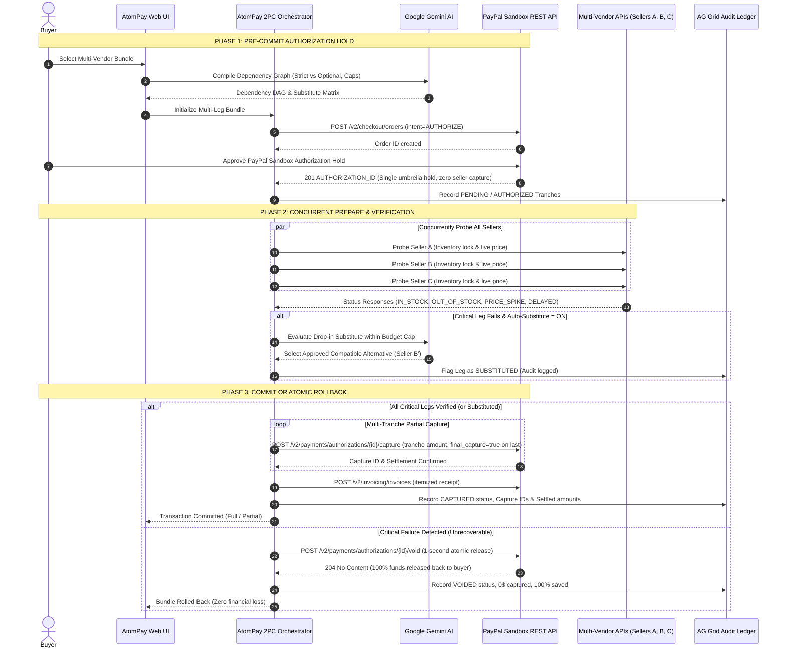

# AtomPay — AI-Guided Two-Phase Commit (2PC) Atomic Multi-Vendor Checkout for PayPal

[](LICENSE)
[](https://developer.paypal.com)
[](https://www.ag-grid.com)
[](https://ai.google.dev)
[](https://www.typescriptlang.org)

**AtomPay** solves the **multi-vendor partial-failure dilemma** in modern multi-store and marketplace checkouts. When buying interdependent components from multiple sellers (e.g. an E-mount camera body from Seller A and a compatible lens from Seller B), traditional carts charge your card sequentially. If Seller B runs out of stock or spikes prices, you are left with half an unusable setup, stranded funds, and manual refund disputes.

AtomPay brings **Distributed Two-Phase Commit (2PC)** into consumer e-commerce powered by **PayPal Orders v2 Authorization Holds**, **Gemini AI dependency analysis**, and an enterprise **AG Grid Settlement & Audit Ledger**.

---

## 🏗️ Architecture & 2PC Sequence Diagram



---

## 🌟 Key Features

### 1. AG Grid Settlement & Audit Ledger (Sponsor Prize Showcase)
* **Real-time Financial Audit Trail**: Powered by `ag-grid-react` & `ag-grid-community` v33.
* **Granular Tranche Tracking**: Displays every PayPal `order_id`, `authorization_id`, per-seller tranche status (`AUTHORIZED`, `CAPTURED`, `VOIDED`, `SUBSTITUTED`), amounts, timestamps, and AI decision notes.
* **Instant Search & Filtering**: Built-in AG Grid QuickFilter across seller names, transaction IDs, SKUs, and AI reasoning.
* **Dual Audit Export**: One-click **Export CSV** (accounting / ERP ready) and **Export JSON** (cryptographic audit ready).
* **Financial KPI Summary**: Live cards showing total funds authorized, settled captures, voided protections, and AI substitution ratios.

### 2. Live Multi-Seller Scenarios & Fault Simulator
* **Preset 1: Creator Camera Rig (3 Sellers)**:
  * Camera Body (*OpticVault Pro* — $185.00) [CRITICAL]
  * 35mm Prime Lens (*LensHub Depot* — $95.00) [CRITICAL, depends on Body]
  * Variable ND Filter (*RigCraft Studio* — $28.00) [OPTIONAL, depends on Lens]
* **Preset 2: AI PC Workstation (3 Sellers)**:
  * AMD Ryzen 9 9900X CPU (*SiliconBay Parts* — $140.00) [CRITICAL]
  * ASUS ProArt X870 AM5 Motherboard (*BoardWorks Direct* — $110.00) [CRITICAL, depends on CPU]
  * M.2 Thermal Shield (*CoolLab Mods* — $22.00) [OPTIONAL]
* **Preset 3: Startup Cloud & API Pack (3 Sellers)**:
  * Production `.ai` Domain (*NameForge Registry* — $70.00) [CRITICAL]
  * Dedicated GPU Credits (*TensorGrid Cloud* — $120.00) [CRITICAL, depends on Domain]
  * Real-Time Observability Add-on (*PulseOps SaaS* — $25.00) [OPTIONAL]
* **Seller-Level Live Fault Injection Controls**:
  * `IN_STOCK`: Normal operational state.
  * `OUT_OF_STOCK`: Seller reports zero remaining inventory.
  * `PRICE_SPIKE`: Live price spikes +28%, exceeding maximum allowed tolerance cap.
  * `DELAYED`: Simulated fulfillment network timeout (>5000ms delay during 2PC prepare).

### 3. Google Gemini AI Engine
* **Semantic Dependency Analysis**: Analyzes natural language buyer prompts to infer hard compatibility requirements vs optional accessories.
* **Automatic Compatible Substitution**: When a critical vendor fails, Gemini consults a candidate matrix, checks budget headroom, and automatically swaps in a drop-in replacement without exceeding the authorized PayPal hold amount.

### 4. Direct PayPal Sandbox REST v2 Integration
* `POST /v1/oauth2/token` — Bearer token generation with automated expiration management.
* `POST /v2/checkout/orders` — Orders v2 with `intent: AUTHORIZE`.
* `POST /v2/checkout/orders/{id}/authorize` — Locks total buyer hold.
* `POST /v2/payments/authorizations/{id}/capture` — Sequential multi-tranche captures with `final_capture: true`.
* `POST /v2/payments/authorizations/{id}/void` — Immediate atomic hold cancellation.
* `POST /v2/invoicing/invoices` — PayPal Invoicing v2 itemized settlement receipts.

---

## 🚀 Quick Start Guide

### 1. Prerequisites
* **Node.js** v20+ or v22+
* **npm** v10+

### 2. Configure Environment (`.env`)
Copy the example environment file in the root directory:
```bash
cp .env.example .env
```
Fill in your credentials:
```env
# PayPal Sandbox Credentials (https://developer.paypal.com -> Apps & Credentials)
PAYPAL_CLIENT_ID=your_paypal_sandbox_client_id
PAYPAL_CLIENT_SECRET=your_paypal_sandbox_client_secret
PAYPAL_MODE=sandbox

# Google Gemini API Key (https://aistudio.google.com)
GEMINI_API_KEY=your_gemini_api_key
GEMINI_MODEL=gemini-flash-latest

PORT=4000
FRONTEND_URL=http://localhost:5173
```

> **Note**: If PayPal or Gemini credentials are omitted, AtomPay automatically runs in high-fidelity **Simulated Fallback Mode**, allowing complete interactive demonstrations of 2PC, rollbacks, and AG Grid audit logs without external API dependencies.

### 3. Install All Dependencies
```bash
npm run install:all
```

### 4. Start the Application
Run both backend and frontend concurrently:
```bash
npm run dev
```
* **Frontend Control Plane**: `http://localhost:5173`
* **Backend REST API**: `http://localhost:4000`
* **Health Endpoint**: `http://localhost:4000/api/health`

### 5. Production Build
```bash
npm run build
```

---

## 🧪 Hackathon Judge Test Steps (3-Minute Demo)

Follow these steps to experience AtomPay's three core checkout paths:

### Test Flow A: Happy Path (100% Multi-Vendor Settlement)
1. In the Web UI (`http://localhost:5173`), select **Creator Camera Kit**.
2. Click **"1. Happy Path (All Stocked)"** in the Live Demo Presets.
3. Click **"Compile AI Dependency Graph"** — notice the DAG highlights critical dependencies.
4. Click **"Authorize Order Hold ($308.00)"** (or log into PayPal Sandbox popup with your buyer account).
5. Click **"Execute 2PC Multi-Tranche Capture"**.
6. **Result**: Both the Camera Body and Lens are captured sequentially, an invoice is generated, and status moves to `COMMITTED`. Switch to the **AG Grid Ledger** tab to inspect the settled rows!

### Test Flow B: AI Compatible Substitute Swap (Seller Failure Recovery)
1. Select **Creator Camera Kit**.
2. Click **"2. AI Substitute Swap"** — this marks the 35mm Sigma Lens as `OUT_OF_STOCK` and enables **AI Substitute Recovery**.
3. Click **"Authorize Order Hold"**.
4. Click **"Execute 2PC Multi-Tranche Capture"**.
5. **Result**: Gemini detects that the Sigma lens is out of stock, retrieves the compatible Sony FE 35mm from *PixelStreet Co*, confirms it fits within the authorized budget, swaps the item, and captures the tranches cleanly (`PARTIAL_COMMITTED` or `COMMITTED`). Check the AG Grid Ledger to see the `SUBSTITUTED` badge and audit note!

### Test Flow C: 2PC Atomic Rollback (Buyer Protection)
1. Select **AI PC Workstation**.
2. Click **"3. 2PC Atomic Rollback"** — this marks the AM5 Motherboard as `OUT_OF_STOCK` and sets Auto-Substitute to **OFF**.
3. Click **"Authorize Order Hold"**.
4. Click **"Execute 2PC Multi-Tranche Capture"**.
5. **Result**: Because the motherboard is missing, the CPU cannot function. AtomPay **immediately issues `POST /v2/payments/authorizations/{id}/void`**. The entire hold is dissolved in under 1 second. The buyer is charged **$0.00**. Inspect the AG Grid Ledger to see the `VOIDED` status and `$0.00` settled amount!

---

## 📁 Repository Structure

```
atompay-paypal/
├── .env.example              # Environment variables template
├── .gitignore                # Excludes secrets & node_modules
├── LICENSE                   # MIT License
├── README.md                 # Project architecture & test guide
├── render.yaml               # Render production deployment blueprint
├── backend/
│   ├── src/
│   │   ├── config/env.ts     # Environment & PayPal URL config
│   │   ├── routes/           # Express API endpoints (/bundles, /vendors, /health)
│   │   ├── services/
│   │   │   ├── gemini.ts     # Gemini AI dependency graph & recovery
│   │   │   ├── orchestrator.ts# 2PC state machine & ledger store
│   │   │   ├── paypal.ts     # PayPal Sandbox REST v2 client
│   │   │   └── vendors.ts    # Multi-vendor presets & live fault injector
│   │   ├── types/atompay.ts  # Shared TypeScript contracts
│   │   └── index.ts          # Express server bootstrap
│   ├── package.json
│   └── tsconfig.json
└── frontend/
    ├── src/
    │   ├── api/client.ts     # Typed frontend API client
    │   ├── components/
    │   │   ├── DagVisualizer.tsx    # Interactive dependency graph & 2PC trigger
    │   │   ├── LedgerGrid.tsx       # AG Grid settlement & audit ledger
    │   │   ├── ScenarioBuilder.tsx  # Multi-seller presets & live fault simulator
    │   │   ├── TopBar.tsx           # Health badges & tab navigation
    │   │   └── WireInspector.tsx    # Live PayPal REST wire trace
    │   ├── types/atompay.ts  # Frontend TypeScript contracts
    │   ├── App.tsx           # Main application state
    │   └── main.tsx
    ├── package.json
    └── vite.config.ts
```

---

## ☁️ Deployment (Render)

This repository includes a turnkey `render.yaml` blueprint:
1. Connect this repo to **[Render.com](https://render.com)**.
2. Select **Blueprints -> New Blueprint Instance**.
3. Render will deploy:
   * `atompay-backend` (Node Web Service on port 4000)
   * `atompay-frontend` (Static Web Service with `/api/*` rewrite proxy)
4. Add `PAYPAL_CLIENT_ID`, `PAYPAL_CLIENT_SECRET`, and `GEMINI_API_KEY` under the Environment variables tab.

---

## 👥 Authors & License

* **SaiSanthosh31** — Co-Creator & Architect
* **dharanii-07** — Co-Creator, 2PC Engine, AG Grid Audit Ledger & Multi-Seller Simulator

Licensed under the [MIT License](LICENSE).
